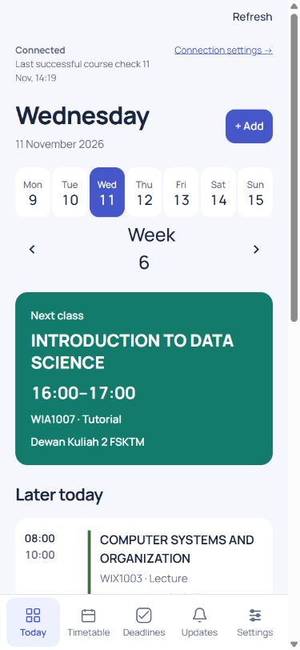
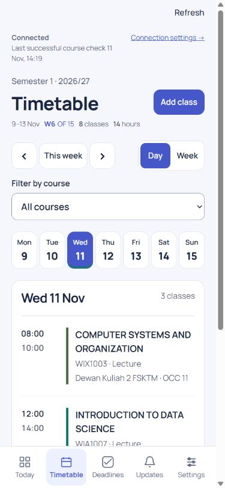
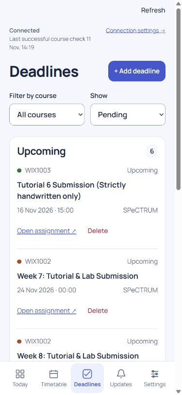

<p align="center">
  
</p>

<h1 align="center">Better Spectrum</h1>

<p align="center">Your timetable, deadlines, and SPeCTRUM updates in one place.</p>

<p align="center">
  <a href="https://um-student-manager.campus-planner-a19743.workers.dev/">Open the app</a> ·
  <a href="#screenshots">Screenshots</a> ·
  <a href="#installation">Installation</a> ·
  <a href="#local-development">Local development</a>
</p>

Better Spectrum is an independent student planner built for Universiti Malaya students. See what is happening today, plan a semester, follow assignment deadlines, and receive reminders on your phone while the cloud handles background checks.

The app works in a browser and can be added to your Home Screen. Access is invitation-only: each student has a separate planner, SPeCTRUM connection, and registered devices.

> This is a personal project, not an official Universiti Malaya service. Always check SPeCTRUM and your university timetable for authoritative information.

## Screenshots

The app's responsive iPhone layout, with bottom navigation and touch-friendly controls.

| Today | Timetable | Deadlines |
| :---: | :---: | :---: |
|  |  |  |
| Your next class and daily agenda. | Semester weeks and daily classes. | Upcoming assignments and filters. |

*Captured from the deployed app on 11 November 2026 using an iPhone-sized browser viewport. These show the responsive web layout, not a physical iPhone or native iOS app. The existing course schedule is not a timetable template.*

## Features

| Feature | What you can do |
| --- | --- |
| **Daily agenda** | Browse days and weeks, see the class in progress, and check upcoming deadlines. |
| **Day and week timetables** | View colour-coded courses, class times, rooms, and semester week numbers. Filter by course and inspect individual classes. |
| **Semester planning** | Define term dates, teaching weeks, excluded dates, and repeating classes. Preview changes before saving, and import/export semester definitions as JSON. |
| **Class exceptions** | Edit or cancel a particular occurrence without losing that change when the semester plan is updated. |
| **Deadlines** | Add and edit manual tasks, mark them complete, and view assignments imported from SPeCTRUM. Imported submission status is confirmed by SPeCTRUM. |
| **Course updates** | Browse materials, announcements, and deadline updates, filter by course, and mark updates read. |
| **Group-aware sync** | Use current Moodle group membership and supported OCC/tutorial labels to filter course content and reminders. |
| **Phone notifications** | Receive class and deadline reminders and course update alerts on registered devices. Cloud jobs keep running when your laptop is off. |
| **Attendance assistance** | Connect a matching SPeCTRUM account and optionally enable automatic marking for eligible sessions that match a saved class. Verified results appear in Updates. |
| **Drafts and recovery** | Keep unfinished forms across refreshes in the same tab. Recover removed classes and deadlines with Undo or the removed-items list. |
| **Private accounts** | Sign in using an invited email and an eight-digit code. Records and connected credentials belong to the signed-in planner. |

All timetable and deadline displays use **Malaysia time (MYT, UTC+8)**.

## Installation

### Use the hosted app

1. Open [Better Spectrum](https://um-student-manager.campus-planner-a19743.workers.dev/).
2. Enter the email address invited by the operator.
3. Enter the eight-digit code sent to your inbox.
4. Plan your semester, or connect SPeCTRUM from **Settings → SPeCTRUM connection**.

There is no public registration. Contact the deployment operator if your email has not been invited.

### Add to iPhone Home Screen

1. Open the app in **Safari** and sign in.
2. Open Safari's **Share** menu and choose **Add to Home Screen**.
3. Launch Better Spectrum from its new icon.
4. Enable **Notifications** in the app's Settings and allow the system request. Use the notification test available through Help to check this device.

The Home Screen web app is the supported iPhone installation route. Notification permission and registration are device-specific; enabling them on a desktop does not enable them on your phone.

### Desktop and Android

Use the app directly in your browser. Where supported, use the browser's **Install app** or **Add to Home Screen** option for a standalone window. Enable notifications separately on each device where you want reminders.

### Connect SPeCTRUM

Course sync requires your own supported Moodle mobile access token. Follow the connection guide in Settings and keep the token private.

Attendance uses a separate connection. The primary route is your signed-in SPeCTRUM profile's **More Details → Mobile app → View QR code**. Choose that account sign-in QR image in the planner's connection settings. This is different from a lecturer's attendance QR code. Successful connection leaves automatic marking off until you enable it.

## Local development

### Requirements

- Node.js **22 or later**, npm, and Git.
- A Supabase Auth project with a working email sender for actual sign-in.
- Cloudflare resources and credentials only when deploying to the cloud.

### 1. Clone and prepare the app

```sh
git clone https://github.com/CheeHoong0402/Better-Spectrum.git
cd Better-Spectrum/mvp
npm ci
node scripts/local-setup.mjs
npm run db:local
```

The setup script creates ignored `.dev.vars` with local encryption and push keys. The database command initializes a local D1 database. It starts without personal records or a built-in login bypass.

### 2. Configure email sign-in

Add your development Auth project's public configuration to `.dev.vars`, keeping the generated encryption and push values:

```dotenv
SUPABASE_URL="https://YOUR_PROJECT.supabase.co"
SUPABASE_PUBLISHABLE_KEY="YOUR_PUBLISHABLE_KEY"
```

Configure Supabase to send an **eight-digit email OTP**, include `{{ .Token }}` in its email template, and use a ten-minute expiry. Disable public sign-ups and configure a working SMTP sender for invited recipients.

Create a confirmed development identity in Supabase Auth, then add its immutable Auth user ID and email to the local D1 allowlist. For example, save the following as ignored `.private/local-user.sql`, replacing the example values:

```sql
INSERT INTO users (id, auth_subject, email)
VALUES ('dev-user', 'YOUR_SUPABASE_AUTH_USER_UUID', 'you@example.com');
```

Apply it to the **local** database:

```sh
npx wrangler d1 execute DB --local --file .private/local-user.sql
```

Use a separate development Auth project and identity. The [account provisioning guide](mvp/MULTI_USER_MIGRATION.md#auth-setup) explains the operator's scripted provisioning flow.

### 3. Start the development server

```sh
npm run dev
```

Open the local URL printed by Wrangler and sign in with the configured development email. `predev` builds the service worker and release manifest automatically. Local configuration lives in `wrangler.jsonc`; keep real production resource IDs out of it.

### Development commands

Run these from `mvp/`:

| Command | Purpose |
| --- | --- |
| `npm run dev` | Build generated public assets and start the local Worker. |
| `npm run check` | Check JavaScript syntax across the application and scripts. |
| `npm test` | Run the Node.js test suite. |
| `npm run test:http` | Exercise the Worker against a disposable local database and temporary test sessions. |
| `npm run build` | Generate public release metadata, the service worker, and bundled assets. |
| `npm run backup` | Create a verified production database backup using local production configuration. |
| `npm run deploy` | Run checks and tests, then execute the production release process. |

The HTTP tests use their own temporary sessions and database; they do not grant the application a bypass login.

## Deployment

The web app uses **Cloudflare Workers**, **D1**, and **Queues**, with **Supabase Auth** for email-code login. Reminder and course-check jobs run in the cloud.

The GitHub workflow checks pull requests and configured branch pushes. A passing commit on `main` can deploy to the configured Worker. Releases verify the live commit identifier, public asset hashes, and private API protection.

See [Deployment and recovery](mvp/DEPLOYMENT.md) for repository variables, Cloudflare permissions, production secrets, backups, and rollback. See the [multi-user migration runbook](mvp/MULTI_USER_MIGRATION.md) when upgrading an older single-user installation. Do not reapply the historical ownership migration to an already migrated database.

## How it is built

```text
Browser / Home Screen app
          │
          ▼
   Cloudflare Worker ───── Supabase Auth
          │
          ├── D1: accounts, planner records, connections, and jobs
          ├── Queues: background course checks and reminders
          ├── SPeCTRUM: Moodle course and attendance integration
          └── Web Push: registered browser and phone subscriptions
```

The frontend uses HTML, CSS, and JavaScript modules. There is no frontend framework or required native build.

```text
mvp/
  public/       Web interface, icons, and manifest
  src/          Worker, authentication, records, scheduling, and integrations
  migrations/   Database migrations
  scripts/      Setup, build, backup, deployment, and verification tools
  test/         Application tests
  test-support/ Disposable database fixtures and helpers
ios/            Optional WKWebView companion source
docs/           README screenshots
```

The [iPhone companion](ios/README.md) is experimental source for build checks. It is not an App Store or TestFlight release, and native notification setup is not implemented.

## Limits to know

- **Invitation-only:** separate personal planners are supported; public registration and shared planners are not.
- **Not a university timetable importer:** enter and review your semester dates and classes against MAYA or TimeEdit. Automatic timetable retrieval is not implemented.
- **Sync is periodic:** background checks are bounded and can be delayed by upstream failures or queue load. The app reports incomplete checks; use SPeCTRUM to confirm uncertain information.
- **Attendance is opt-in:** automatic marking uses eligible sessions matching your saved timetable. Turn it off when you are not attending. WIX1003 and sessions requiring lecturer passwords, attendance QR codes, or restricted networks stay manual. Uncertain attempts are not blindly retried.
- **Offline support covers the app shell:** a fresh offline launch cannot retrieve private records. Already loaded records may remain visible with a freshness warning.
- **Push delivery needs a device check:** a successful server send does not guarantee the phone displayed a notification.
- **Semester size is bounded:** up to 40 weekly rows and 1,000 generated dated occurrences. Weekly classes must start and end on the same day.

## Privacy

Personal records stay in D1 and are scoped to the signed-in owner. Connected SPeCTRUM credentials are encrypted for that owner; private API responses are not cached by the service worker. Push titles and bodies use generic wording to reduce disclosure on shared or locked devices.

Do not commit `.dev.vars`, production configuration, credentials, QR sign-in images, or database backups. Signing out ends the session; it does not delete cloud records. Account removal is an operator action.
